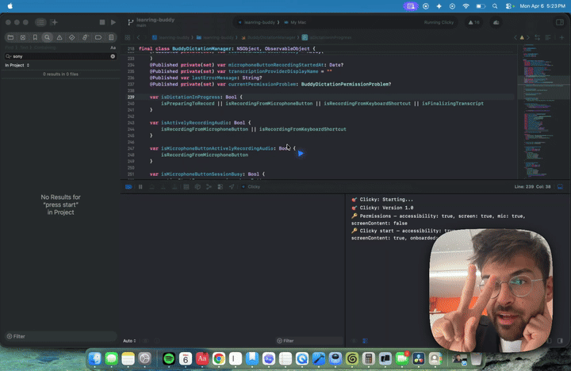

# OpenClicky

An AI buddy that lives next to your cursor on macOS. It can see your screen, talk to you, and fly over to point at things, like having a teacher sitting next to you.

OpenClicky is a fork of [Clicky](https://github.com/farzaa/clicky) by Farza (MIT licensed) with one big difference: **it runs on the Claude Code already installed on your Mac.** No Cloudflare Worker, no API keys, no accounts, no analytics. Your screenshots go from your Mac to Claude through your own Claude Code login, and nowhere else.



## What it can do

**Talk.** Hold **Control + Option**, ask anything out loud, and let go. OpenClicky screenshots your screen, asks Claude through your local Claude Code, and answers out loud with captions. It boots Claude Code while you're still talking and speaks each sentence as soon as Claude writes it, so answers start about a second after you let go. It also tells Claude which app and window you're in and any text you have selected, so "what does this mean?" about a highlighted sentence just works. Press **Escape** to stop it mid-sentence. It remembers the conversation (the last 40 messages) and what it learns about you.

**Draw on your screen to ask.** While holding Control + Option, drag with the mouse or trackpad to circle, underline or arrow the thing you mean ("what's *this* number?"). Your marks show up in coral on screen and are burned into the screenshot Claude sees. The drag doesn't reach the app underneath, so nothing gets selected or moved.

**Status pill.** A black pill hangs from the top of the screen, wrapping the notch on MacBooks. It shows **Listening** with a live mic waveform, **Thinking**, or **Speaking**, expands to show captions of what OpenClicky is saying, and shows how many agents are working.

**A teaching board, every time.** Ask anything and a whiteboard appears next to your work and fills in live while Claude thinks: "solve this" gets the full worked solution step by step with real math typesetting, a boxed answer and a check; "why is this broken" gets what's wrong, why, and the fix in highlighted code; "how does X work" gets the key idea, a small diagram and the takeaway. OpenClicky only says one to three sentences out loud, so it never rambles. The board stays up so you can ask follow-ups ("why step 2?", "do the next one") and it redraws. Close it with × or Escape, or drag it by its title.

**Point and draw back.** While it talks, the blue cursor flies to the thing it's describing, and it draws on your screen like someone with a gold marker. Drawings go on one after another at pen speed, with a glowing pen tip, soft ink bleed, a highlighter that sweeps across, labels that pop out on leader lines, and sticky notes that drop onto the screen. It can draw:
- circles, arrows, highlights and underlines
- callout labels with leader lines that name the parts of whatever's on screen ("Lift fan", "22-pin end")
- sticky notes with a curled corner for warnings and key tips ("Power off / Unplug first")

**Real-time graphics.** When a picture explains it better, Claude draws an explainer card next to what you're looking at:
- **whiteboard diagrams**: hand-drawn boxes, arrows and numbered steps on grid paper that draw themselves in while it talks
- **3D models**: a simplified, draggable 3D model of a physical thing (an engine, a device) with labeled, clickable parts

It starts talking right away while the card is still being drawn.

**Agents (do anything).** Ask it to *do* something ("research the best free video editors and make me a comparison", "organize my downloads folder", "make a reminder for Friday", "build me a little web page") and it hands the job to a background **Claude Code agent**. Agents get the full toolset: files, terminal, web search, Mac app control through AppleScript, and every MCP server you've connected to Claude Code (Gmail, Notion, Linear, calendars and so on). Each agent gets a frosted-glass card in the top-right corner showing what it's doing live, with an elapsed timer:
- a 5-second countdown, so you can cancel a misheard request
- approval prompts for sensitive actions: **Allow once / Always allow / Not now** (or set "Always approve" in Settings)
- Stop, Retry, Open folder, and Reply with follow-ups to the same agent
- a spoken summary when it finishes

Say "agent, ..." to skip straight to an agent. Results land in `~/OpenClicky/<date> <agent name>/`.

**Choose how it hears you.** On first launch OpenClicky checks which speech-to-text engines your Mac has and asks you to pick one (change it anytime in Settings → Transcription):
- **Apple SpeechAnalyzer**: Apple's newest on-device model (macOS 26+). Downloads its language model once.
- **Whisper (whisper.cpp)**: uses **every Whisper model already on your Mac**, including ones downloaded by **Superwhisper**, MacWhisper, VoiceInk, Buzz, Hugging Face tools, Homebrew or your Downloads folder, plus anything Spotlight finds. Models are recognized by their file header, not their name, so renamed models are labeled correctly ("Large v3 Turbo q5_0, from Superwhisper"). You can also download Base, Small or Large v3 Turbo in one click. Runs **inside OpenClicky** on the GPU (Metal), using the official whisper.cpp framework bundled as a Swift package (`Packages/WhisperFramework`, pinned by checksum), so there's nothing extra to install. The model stays loaded between presses. Models in formats whisper.cpp can't run (Core ML, Parakeet, ONNX) are listed so you know why they're not offered.
- **Apple Speech**: built in, on-device, zero setup.
- AssemblyAI / OpenAI (cloud): only listed if you added your own key.

**Dictation.** Hold **Fn + Control** in any app, speak, and let go: your words are typed where your cursor is. Double-tap Fn + Control for hands-free mode. Start with "draft a reply saying..." and OpenClicky reads the screen and writes the message in your voice. Optional: polish dictation with Claude (removes filler words, fixes punctuation), and a personal dictionary for names and jargon.

**Settings** (menu bar panel → Settings): voice picker with preview, speed 0.5x–1.5x, captions, dictation options, agent permissions, memory (`PROFILE.md` is a plain file you can edit), talk model (Haiku / Sonnet / Opus).

### Under the hood

| | Upstream Clicky | OpenClicky |
|---|---|---|
| Claude | Anthropic API via a Cloudflare Worker you deploy | Your local `claude` CLI (your Claude Code subscription/login) |
| Speech-to-text | AssemblyAI via the Worker | Apple Speech, on-device (AssemblyAI/OpenAI optional with your own key) |
| Text-to-speech | ElevenLabs via the Worker | macOS voices, on-device (ElevenLabs optional with your own key) |
| Analytics | PostHog (sends transcripts) | None |
| Email signup | FormSpark | None |
| Agents, drawing, diagrams, 3D, dictation, memory | — | Built in, all through local Claude Code |

## Download

Grab **OpenClicky.dmg** from this repo's [Releases](../../releases) page (the `latest` release is rebuilt automatically from every push to `main` by `.github/workflows/build-macos.yml`).

### Or build the DMG yourself

On a Mac with Xcode 26+, run:

```bash
./scripts/build-dmg.sh
```

It produces `OpenClicky.dmg` in the project folder. (Private GitHub repos have limited free macOS build minutes; public repos build for free.)

### Installing the download

1. Open the DMG and drag **OpenClicky** into **Applications**.
2. Open it. macOS will say it can't verify the developer, because the build is ad-hoc signed rather than signed with a paid Apple Developer ID. Go to **System Settings → Privacy & Security**, scroll down, and click **Open Anyway**. You only need to do this once.
   (Or in Terminal: `xattr -dr com.apple.quarantine /Applications/OpenClicky.app`)
3. Make sure [Claude Code](https://claude.com/claude-code) is installed and you've run `claude` once to log in.
4. Click the triangle in the menu bar, grant the permissions, pick a voice engine, and hit Start.

After installing a newer build, macOS may ask for Accessibility and Screen Recording again, because each ad-hoc build has a new signature. To avoid that (and the warning in step 2), add a Developer ID certificate and notarization to the workflow.

## Requirements

- macOS 14.2+
- Xcode 26+ (the project uses Swift's default-MainActor isolation)
- Internet on the first build, so Xcode can fetch Sparkle and the whisper.cpp framework (about 63 MB)
- [Claude Code](https://claude.com/claude-code), installed and logged in. Run `claude` once in Terminal and finish login.

## Setup

```bash
git clone <your-openclicky-repo-url>
cd openclicky
open leanring-buddy.xcodeproj
```

In Xcode:
1. Select the `leanring-buddy` scheme. Yes, the typo is inherited from upstream and the folder names stay as they are.
2. Under **Signing & Capabilities**, pick your own team.
3. **Cmd + R**.

OpenClicky appears in the menu bar, not the Dock. Click the triangle, grant the four permissions (Microphone, Accessibility, Screen Recording, Screen Content), hit **Start**, then hold Control + Option and talk.

### If OpenClicky can't find Claude Code

Apps launched from Finder don't get your shell's `PATH`. OpenClicky looks in `~/.claude/local`, `~/.local/bin`, `/opt/homebrew/bin`, `/usr/local/bin`, `~/.npm-global/bin`, `~/.bun/bin`, `~/.volta/bin` and `~/.nvm/versions/node/*/bin`, and also asks your login shell. If yours is somewhere else:

```bash
defaults write com.openclicky.app ClaudeCodeCLIPath "$(which claude)"
```

Then click **Re-check** in the panel.

## Options

**Model.** Pick Sonnet or Opus in the panel. These are Claude Code aliases, so you always get the latest one your plan includes.

**Voice.** OpenClicky uses the best English macOS voice you have installed. For a much nicer one, download a *Premium* or *Enhanced* voice in System Settings → Accessibility → Spoken Content → System Voice → Manage Voices. To force a specific voice:

```bash
defaults write com.openclicky.app LocalSpeechVoiceIdentifier com.apple.voice.premium.en-US.Zoe
```

**Cloud speech (optional).** To use upstream's ElevenLabs voice or AssemblyAI transcription, put **your own** keys in `leanring-buddy/Info.plist`: `ElevenLabsAPIKey` (+ `ElevenLabsVoiceID`), `AssemblyAIAPIKey`, or `OpenAIAPIKey`, and set `VoiceTranscriptionProvider` to `assemblyai`/`openai`. Keys there are compiled into your build, so don't distribute a build that contains them. If ElevenLabs fails, OpenClicky falls back to the macOS voice.

## Privacy

- A screenshot is only taken when you hold the hotkey.
- Screenshots and transcripts go to Claude through your local Claude Code, under your Claude account's terms. Nothing else is sent anywhere.
- In **talk mode**, Claude Code runs with all tools disabled (`--tools ""`), no MCP servers and no session persistence, from its own scratch folder, so it can only look and talk.
- **Agents** do have tools. By default every sensitive action (writing files, running commands, using connected apps) shows an approval card first. Agents are told never to delete things outside their folder, send messages, buy anything or post publicly unless you explicitly asked.
- 3D model cards load three.js from the jsDelivr CDN. Everything else stays on your Mac or goes to Claude.
- Memory lives in `~/Library/Application Support/OpenClicky/` (`PROFILE.md`, `conversation.json`). Turn it off or clear it in Settings.

## Not affiliated

OpenClicky is the open-source Clicky codebase rewired to local Claude Code, with its own independent implementations of features similar to those described in HeyClicky's public changelog. It contains no HeyClicky code or assets, and it isn't affiliated with or endorsed by HeyClicky / Humansongs, Inc.

Not included: a Windows version, the notch UI, a Chrome extension, scheduled routines, accounts and billing.

## Architecture

See [`AGENTS.md`](AGENTS.md) (also `CLAUDE.md`) for the full breakdown. The short version:

- `CompanionManager.swift` — the state machine: hotkey → dictation → screenshot → Claude → speech → pointing.
- `ClaudeCodeCLIClient.swift` — spawns `claude -p --input-format stream-json --output-format stream-json --include-partial-messages`, sends the screenshot(s) and transcript as one message, and streams text deltas back.
- `LocalSpeechTTSClient.swift` — macOS voice TTS, plus the optional ElevenLabs fallback chain.
- `OverlayWindow.swift` — the blue cursor buddy and its pointing animation.
- `ScreenAnnotations.swift` — parses drawing/agent/memory tags and renders circles, arrows, labels and sticky notes.
- `VisualExplainerCards.swift` — whiteboard diagram and 3D model cards (WKWebView).
- `OpenClickyAgents.swift` + `AgentCardsPanel.swift` — background Claude Code agents and their cards.
- `OpenClickyDictationController.swift` — Fn + Control dictation into any app.
- `OpenClickySettings.swift` + `OpenClickySettingsWindow.swift` — preferences, memory and the Settings window.

## License

MIT. See [LICENSE](LICENSE). Original work © 2026 Farza.
